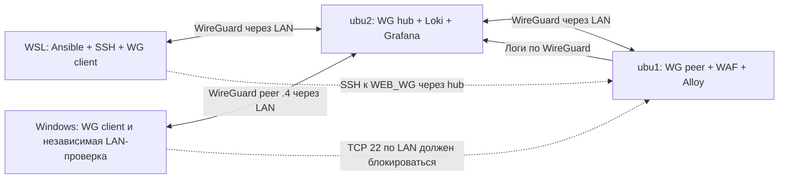

# Архитектура стенда

Две VM созданы после согласования плана, их собственные DHCP leases закреплены. WireGuard, guest firewall и защищённый SSH применены; проверка доступа и отдельный commit rollback transaction пройдены. WAF и централизованные логи прошли приёмку. Раздельные проверки недоступности Loki и обычного рестарта Alloy, две ротации и согласованные последовательные reboot прошли; после reboot полные secure/site снова дали `changed=0` на обеих VM. Подтверждённые ограничения описаны ниже. Предварительный [аудит](audit.md) описывает состояние до создания. Домашние адреса, MAC и реальные инфраструктурные идентификаторы в публичную документацию не включаются.

## Узлы и ресурсы

| Узел | Выделенный размер | Назначение |
|---|---|---|
| ubu1 | 2 vCPU, 2 GiB RAM, 20 GiB disk | Nginx, ModSecurity, CRS, Alloy, WireGuard peer |
| ubu2 | 2 vCPU, 4 GiB RAM, 30 GiB disk | WireGuard hub, Loki, Grafana |
| WSL | Существующая среда | Git, Ansible, SSH, WireGuard client, проверки |

Итого — 4 vCPU, 6 GiB RAM, 50 GiB виртуальных дисков. Предварительный аудит подтвердил достаточный запас ресурсов; его значения свободного места относятся к моменту до клонирования. Thin storage не резервирует физические блоки навсегда: ограничиваются логи/retention и число snapshots, поскольку общий pool используют другие VM. Гости — Ubuntu 24.04 LTS; управляющий WSL — Ubuntu 26.04 LTS.

Выполнены полные клоны cloud-init template, подтверждённого владельцем; ОС и guest agent проверены внутри новых гостей. Параметры: 1 socket × 2 cores, CPU host, фиксированная RAM (balloon 0), VirtIO NIC, VirtIO SCSI и отдельные диски. Существующая сеть гипервизора не перестраивалась. Независимый recovery-канал — проверенное выполнение команд через QEMU Guest Agent; serial console не выдаётся за проверенный парольный вход.

Используется согласованная общая LAN. Guest firewall имеет INPUT/FORWARD/OUTPUT default deny, точечные исключения и запрет прочего egress в домашние/приватные сети. Это ограничение доступа внутри общей L2, без VLAN и изменения PVE firewall. Оно не обеспечивает containment от root, способного отключить гостевые правила. Два проектных WAN DNAT созданы выключенными; порядок временного включения — в [application-plan.md](application-plan.md).

## Адреса и маршруты

| Символ | Значение |
|---|---|
| UBU1_LAN / UBU2_LAN | Фактические DHCP leases закреплены; значения только в локальных inventory |
| VPN_CIDR | Отдельный проектный 10.77.42.0/29 |
| HUB_WG / WEB_WG / ADMIN_WG / REVIEWER_WG | 10.77.42.1 / .2 / .3 / .4; peer .4 включён для локального теста Windows |
| ADMIN_LAN | Проверенный LAN-source управляющего Windows после WSL NAT; временный SSH-доступ с него уже убран |

Адреса не выбирались по ping/ARP: закреплены только реально выданные двум новым MAC leases. DHCP pool и чужие leases не менялись. При воспроизведении адреса и свободные VMID снова проверяются до создания; этот документ не резервирует значения.

У гостей Address использует небольшой /29 connected prefix, а AllowedIPs peers — только точные /32. В WSL маршруты туннеля ограничены /32 адресами hub и web; LAN/default routes не добавлены. На текущем WSL транспортном интерфейсе MTU 1280. Клиентскому wg0 задан постоянный IPv4 MTU 1200; MTU гостевых WG-интерфейсов остался 1420. Первоначальный клиентский 1420 приводил к зависанию SSH на KEX; после уменьшения новые SSH и sudo через VPN прошли на обе VM. Это настройка конкретного клиентского пути, а не универсальный MTU всех peers.

WireGuard на ubu2 удовлетворяет заданию. Дополнительный peer на ubu1 позволяет разрешить SSH именно на `wg0`, а не доверять одному лишь адресу VPN, который можно попытаться подставить в пакете из LAN.

| Узел | AllowedIPs для соответствующего peer |
|---|---|
| ubu2 → peer ubu1 | WEB_WG/32 |
| ubu2 → peer WSL | ADMIN_WG/32 |
| ubu2 → peer Windows | REVIEWER_WG/32 |
| WSL → peer ubu2 | HUB_WG/32, WEB_WG/32 |
| Windows → peer ubu2 | HUB_WG/32, WEB_WG/32 |
| ubu1 → peer ubu2 | HUB_WG/32, ADMIN_WG/32, REVIEWER_WG/32 |

На ubu2 включён IPv4 forwarding только для разрешённых потоков между WG peers. Внутри туннеля NAT отсутствует. Новые SSH-сеансы к обеим VM и sudo проверены; доступ к web проходит через hub. Маршрут по умолчанию WSL и домашняя маршрутизация не менялись. Механизм AllowedIPs описан в [WireGuard](https://www.wireguard.com/).

Дополнительно подключён native Windows WG-клиент `.4/32` с отдельным ключом, MTU1420 и только двумя AllowedIPs: hub `.1/32` и web `.2/32`. DNS и default route не меняются. Transport endpoint находится в домашней LAN; UDP-ответы hub разрешены на текущий LAN-source этого ПК. При смене его LAN-адреса это исключение нужно пересмотреть. Native Windows Grafana health200, web200/SQLi403 и центральный source IP `.4` проверены; WSL `.3` продолжил работать. Это не внешний WAN-тест. Правила с `lab_reviewer_enabled=true` применены на обеих VM; локальное переопределение хранится в host vars фактического inventory.

## Разрешённые потоки

INPUT/FORWARD/OUTPUT default deny; loopback и необходимые established/related разрешены. В OUTPUT сначала точечные DHCP/DNS/WG/VPN исключения, затем запрет приватных/специальных адресов, после него публичные NTP/HTTP/HTTPS. IPv6 приложения запрещены, необходимый ND сохранён. Порты стека и временного demo закреплены в application-plan.md.

| Источник → назначение | Транспорт | Цель / ограничение |
|---|---|---|
| WSL, ubu1 и Windows/reviewer peer → ubu2 | UDP 51820 | Гостевой INPUT допускает внешний IPv4 source; принадлежность peer проверяется криптографически. WAN DNAT пока выключен |
| WSL ADMIN_WG → ubu1 WEB_WG | TCP 22 | Только wg0, конкретный WG-IP клиента |
| WSL ADMIN_WG → ubu2 HUB_WG | TCP 22 | Постоянное управление по VPN |
| WSL ADMIN_WG → ubu1 WEB_WG | TCP 80 | Тестовый HTTP через VPN |
| LAN/WAN-клиент → ubu1 LAN | TCP 80 | Только на период demo, guest exception выключено по умолчанию |
| ubu1 WEB_WG → ubu2 HUB_WG | TCP 3100 | Alloy → Loki; только wg0 и IP ubu1 |
| WSL ADMIN_WG → ubu2 HUB_WG | TCP 3000 | Grafana UI; только wg0 |
| Grafana → Loki на ubu2 | Loopback TCP 3100 | Запросы журналов; API-query при необходимости через SSH tunnel |
| Узлы → необходимые resolver/NTP/repositories | UDP/TCP 53, UDP 123, TCP 80/443 при необходимости | DHCP/update зависимости уточнить и документировать |

Forward на ubu2: `wg0 → wg0`, ADMIN_WG → WEB_WG TCP 22/80 и обратный established/related; остальные пересылки drop. Доставка в Loki — INPUT ubu2, а не FORWARD. На ubu1 forwarding не требуется.

Firewall реализован отдельной таблицей nftables семейства `inet`. Загрузка атомарно заменяет только её, без global flush. Проверки интерфейса/source защищённых сервисов выполняются до общего established accept. IPv6 приложения запрещены; сохранён необходимый link-local ND, DHCPv6 выключен по умолчанию. Проверенные LAN IPv4/IPv6 и VPN TCP-порты соответствовали политике, в том числе после reboot; это не полный scan TCP/UDP. После reboot подтверждены IPv4 forwarding web=0/hub=1 и IPv6 forwarding=0 на обеих VM.

## Веб и логи

Прикладной этап использует официальный образ OWASP CRS с Nginx/ModSecurity, закреплённый по версии и digest. WAF работает на ubu1 в host network без published ports; допуск контролирует INPUT гостя. Runtime-проверки подтвердили конфигурацию Nginx, фактический HTTP/80, обычный HTTP200 и SQLi403 с CRS detection/blocking событиями.

Docker создаёт правила для bridge networks; published ports могут обходить ожидаемую UFW-фильтрацию. Для host network Docker таких правил не создаёт, однако слушающие адреса и реальный ruleset всё равно проверяются. Основание: [Docker packet filtering](https://docs.docker.com/engine/network/packet-filtering-firewalls/).

Docker используется только для WAF на ubu1. На hub ubu2 Loki/Grafana работают как native services: Docker bridge rules/FORWARD policy не вмешиваются в VPN hub. Версии и способ установки закреплены в [versions.md](versions.md).

На выделенном web-госте daemon policy явно задаёт `bridge: none`, `iptables: false`, `ip6tables: false`, `ip-forward: false`, `ip-masq: false`. Это допустимо для единственного host-network WAF, которому bridge/NAT не нужны; переносить такую политику на Docker с bridge-контейнерами без пересмотра нельзя. Конфигурация проверяется `dockerd --validate` и активируется до полного описания WAF-контейнера. `ip-forward: false` предотвращает новое включение forwarding Docker-ом, а фактический и постоянный `net.ipv4.ip_forward=0` на ubu1 обеспечивает роль WireGuard. На ubu2 IPv4 forwarding остаётся 1 для разрешённого WG→WG потока.

WAF master запускается от container root с ограниченными capabilities; workers переходят к непривилегированному nginx UID. `FOWNER` нужен startup-генераторам для сохранения mode/ACL после смены владельца временного файла; одного `DAC_OVERRIDE` для этого недостаточно. Host site/config mounts read-only, writable mount ограничен логами. Это лабораторный процесс внутри отдельной VM, а не утверждение о безопасности произвольного root-контейнера.

Перезапуск handler выполняет restart существующего контейнера, сохраняя host network, mounts и env. Частичный вызов `docker_container` с одними name/state/restart на реальном запуске пересоздал его с default bridge/config; это исправлено. Поэтому приёмка проверяет не только Docker healthy, но и фактический network mode, mounts/env, `nginx -t` и HTTP/80: здоровый default listener на другом порту не выполняет требования стенда.

Проверенный обычный запрос: WSL → WG hub → Nginx/WAF ubu1 → статическая тестовая страница → HTTP 200. Отдельного application backend нет. SQLi тем же путём дал HTTP403, access/audit events, SQLi rule942100 и blocking rule949110. Audit transaction ID совпал с access request ID; очищенные результаты — [baseline.json](evidence/baseline.json).

Alloy читает access log и ModSecurity audit log и отправляет их через WG в Loki; оба потока подтверждены централизованными событиями. Labels: `job="ozzylogik"`, `instance="ubu1"`, `service_name="nginx"`/`"modsecurity"`, `log_type="access"`/`"audit"`. Request ID и IP остаются в содержимом, а не labels с высокой кардинальностью. Для каждого теста сохраняются correlation marker, время, наблюдаемый WAF source IP, HTTP status, rule ID и событие из Loki. При HTTP через WG лог подтвердил ADMIN_WG `10.77.42.3`. Grafana успешно проверила подключение к Loki datasource.

Для нового стенда предлагается Alloy: [Promtail завершил поддержку 02.03.2026](https://grafana.com/docs/loki/latest/send-data/promtail/). Это решение по актуальному состоянию компонента, а не требование задания.

Применены постоянные позиции/WAL Alloy, права общей log reader group, ротация access/audit/container logs и Loki retention 7 суток. Journal ограничен базовой ролью. Раздельно проверены доставка после недоступности Loki без рестарта collector, обычный рестарт Alloy при доступном Loki, новая доставка после рестарта и сохранение прежних центральных записей. В каждом таком тесте normal access, SQLi access и SQLi audit найдены по одному разу.

Две ротации подтвердили появление новых запросов в активных access/audit файлах и центральную доставку каждой ожидаемой записи ровно один раз; получены пять gzip-архивов, timer активен, rotation service завершился успешно. Первоначальный HUP оставлял master serial audit descriptor в старом архиве. Применённый helper проверяет `nginx -t`, перезапускает существующий WAF-контейнер и ждёт локальный healthcheck. Это закрывает старые descriptors ценой короткого перерыва HTTP; `copytruncate` не используется. Реальное удаление после семи суток retention ещё не наблюдалось; предел хранения по времени не равен жёсткой byte-квоте.

Согласованные последовательные reboot подтверждены сменой boot ID обеих VM и запуском kernel `6.8.0-147-generic`. После старта повторно прошли HTTP200/SQLi403, access/audit доставка с count1, доступность старого baseline, новые VPN SSH/sudo, отдельные auth refusals и проверки портов. Полные secure/site после reboot дали `changed=0`, `failed=0`, `unreachable=0`. Guard pending отсутствует, rollback timers отключены; оба WAN DNAT свежим чтением подтверждены выключенными.

Более сильный тест выявил ограничение: события, созданные при остановленном Loki, не появились централизованно после рестарта Alloy до восстановления Loki. Исходные host logs сохранились; backfill не выполнялся. Причина потери пока не установлена. Наличие WAL и успешные отдельные тесты не означают гарантии доставки при сочетании отказов.

В закреплённой версии Alloy `max_backoff_retries=0` означает бесконечные повторы, а не немедленный отказ. При завершении процесса очередь имеет отдельный ограниченный `drain_timeout` (по умолчанию 15s), после которого отменяются незавершённые запросы. Это подтверждают [документация v1.21.1](https://github.com/grafana/alloy/blob/v1.21.1/docs/sources/reference/components/loki/loki.write.md) и [обработка shutdown в v1.21.1](https://github.com/grafana/alloy/blob/v1.21.1/internal/component/common/loki/client/shards.go). В текущей эксплуатации сначала восстанавливают Loki и подтверждают доставку, затем перезапускают Alloy; отсутствие потерь и дублей вне проверенных сценариев не предполагается.

## Безопасный переход

Пройден порядок: bootstrap пользователя → guest firewall с ограниченным LAN SSH → WG и новый VPN SSH/sudo → secured SSH/firewall через VPN → независимые проверки → отдельный commit. Таймер 900 секунд сохранялся до приёмки базового доступа; тяжёлый site запускается после commit. При первой активации conntrack исправлено bootstrap-only OUTPUT исключение, чтобы ответ уже открытого SSH не терялся как NEW; secured удаляет LAN-исключение целиком. Существующий established-сеанс не считался доказательством новой политики. При последующих изменениях снова использовать snapshot/rollback и отдельную проверку нового доступа.
